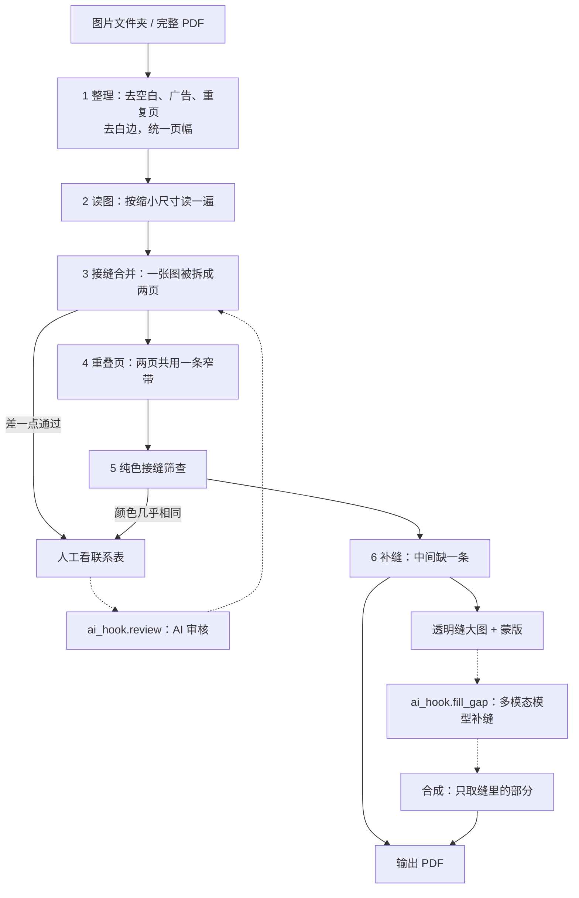

# PhotobookAutoEditor

写真集扫描件的自动整理。输入一个图片文件夹，或一个或多个完整的 PDF，输出每本书一个整理好的 PDF：

- 去掉空白页、广告页、重复页
- 去白边，所有页统一成同一个尺寸
- 被拆成两页的一张图（跨页）合回一张双倍宽的页
- 两页共用一条窄带的重叠页（扫描时中间多扫了一段），去掉重复的部分拼成一页
- 纯色背景的接缝、规则判不了的接缝，排进队列交给人或 AI 看
- 中间缺了一条的两页（老写真），做成带透明缝的大图，留接口让多模态模型来补

没有被修改的 JPEG 会原样嵌进 PDF，不重新压缩。

*English summary: tidies photobook scans (folder of images or PDFs in, one clean PDF per book out): drops blank/ad/duplicate pages, trims borders, equalises page size, merges split spreads and overlapping halves, queues undecidable pairs for a human or AI reviewer, and prepares transparent-gap canvases for an image-capable AI to fill.*

## 快速开始

```
pip install numpy pillow pikepdf scipy opencv-python-headless
python auto.py <文件夹或PDF> [<文件夹或PDF> ...] [--out 输出目录] [--seam fast|full] [--no-trim] [--no-overlap] [--gaps 文件] [--force]
python selftest.py          # 合成数据的回归测试，不碰任何真实文件
```

- 输入是图片文件夹或完整的 PDF，不收 zip（先解压）。
- 输出在 `<out>/<书名>.pdf`（默认 `<输入所在目录>/arranged`），旁边有联系表（`.uncertain.jpg`、`.flat.jpg`）、队列 `.queue.json`、页面图 `.work/`、补缝任务 `.gaps/`。
- 输出 PDF 已存在时会跳过，要重做加 `--force`。

## 流程



| 阶段 | 状态 |
|---|---|
| 1 整理、2 读图、3 接缝合并 | 已完成 |
| 4 重叠页 | 已完成，默认开启（`--no-overlap` 关闭） |
| 5 纯色接缝 | 页对进队列，暂不自动合并 |
| 6 补缝 | 透明缝大图、蒙版、任务单、合成都已写好；补缝本身要接模型，默认不调用任何模型 |
| 完整图版接缝测试的 CUDA 版 | 计划中，未写 |

## 接缝合并怎么判断

每页只解码一次，用能满足 320 行高度的最小 JPEG 缩放，再缩成 272 行高的 RGB 图。相邻两页 A | B 同时满足下面三条才合并（`photobook_lib.py` 的 `seam_match`）：

1. 接缝两侧的颜色差，不超过 B 上下错开 9 到 12 行时颜色差的一半。一张图被切成两半，只有行对行才吻合；两张不同的照片，错开多少都一样差。
2. 接缝处的跳变不超过接缝两侧各自相邻列变化的 2.5 倍。
3. 接缝列沿高度有起伏（一面纯色墙说明不了行有没有对齐）。

`--seam full` 改用原来的方法：完整分辨率、2 像素宽的灰度条加颜色对齐，更慢。

在一个私有库里实测：2856 个已合并的跨页和 6679 对相邻的独立页，快速规则合并了其中 97.5% 的跨页，误合并了 0.16% 的独立页；差一点通过的页对进联系表等人看。

## 重叠页

有的书把一张图扫成两页，两页中间共用一条窄带（实测约占页宽的 3% 到 5%）。这条带在两页里是重复的，不是延续的，所以接缝规则看不出来。

`overlap.py` 的做法：

1. 预筛：在 450 列宽的小图上，取一页外缘的一条窄带，在另一页里做模板匹配，门槛放宽（宁可多放进来）。
2. 确认：通过预筛的页对，在 900 列宽的图上再测一次，要求共用的整条带在颜色上和上下错开的对照相比近乎完全吻合。
3. 拼接：两张 JPEG 原样保留，各自按重叠带中线裁剪后并排，页面宽度是两页的并集，不重新编码。

在一本已知有 29 对重叠页的书上：29 对全部找到，位置误差中位数 0 像素、最大 2 像素；54 对相邻的普通页没有一对被误认。预筛的门槛是在这本书上调的，换一批书之前请先抽查。

## 补缝

两页本来是一张图，但中间缺了一条（老写真常见）。程序不能凭空判断缺了多少，所以由人或 AI 指出哪两页、缺多宽；之后的步骤都是自动的：

1. `gap_repair.make_job` 生成一张 RGBA 大图：左页，一条全透明的缝，右页；再生成同尺寸的蒙版（白色是要补的地方）和一份 json 任务单，放在 `<书名>.gaps/`。
2. 谁来补，按顺序：任务旁边已有 `<任务名>.filled.png` 就直接用；否则调用 `ai_hook.fill_gap(job)`，由多模态/图像编辑模型把透明的那一条补上，返回图片路径。
3. `gap_repair.compose` 只取补好的图在缝里的部分（边缘羽化几个像素），两页原有的像素保持不变，合成一张 JPEG，替换原来的两页。
4. 没人补的任务不会改动书，仍是两页。

指定要补哪些页对有两种方式：

- 人工：`--gaps gaps.json`，内容是 `[{"left": "p0007.jpg", "right": "p0008.jpg", "gap": 0.04}]`。页名是整理后的页面文件名，在 `.work/` 里能看到；`gap` 是缝宽占一页宽的比例。
- AI：实现 `ai_hook.gaps(queue, pages)`，自己翻相邻页判断。

不想接模型、只想看流程怎么走：`python gap_repair.py classic <任务单.json>` 用传统修补填一条很窄的缝，写出 `.filled.png`，再加 `--force` 重跑即可。缝宽的话会很糊，只能当测试用。

单独使用：

```
python gap_repair.py make 左页.jpg 右页.jpg --gap 0.04 --out 目录     # 生成透明缝大图、蒙版、任务单
python gap_repair.py compose 任务单.json 补好.png 成品.jpg            # 合成
```

补出来的内容是模型编造的（尤其是人脸和皮肤），所以默认关闭，只对你点名的页对做。

## AI 接口

`ai_hook.py` 有三个函数，默认都什么也不做，所以默认没有任何东西离开这台机器：

| 函数 | 作用 |
|---|---|
| `review(queue)` | 看规则判不了的页对（差一点通过的、纯色接缝的），返回要合并的页对 |
| `gaps(queue, pages)` | 指出哪些页对中间缺了一条，缺多宽 |
| `fill_gap(job)` | 拿到透明缝大图和蒙版，补好后返回图片路径 |

## 文件

| 文件 | 作用 |
|---|---|
| `auto.py` | 入口：文件夹或 PDF |
| `photobook_lib.py` | 核心：广告页和空白页检测、接缝规则、跨页合并、写 PDF |
| `seam_load.py`、`seam_full.py` | 缩小尺寸读图；完整分辨率的接缝规则 |
| `overlap.py` | 重叠页：预筛、确认、几何 |
| `gap_repair.py` | 补缝：透明缝大图、蒙版、任务单、合成、传统修补 |
| `ai_hook.py` | AI 接口 |
| `overlap_stitch.py` | 对已有的 PDF 做重叠页拼接（单独使用） |
| `merge_pages.py`、`verify_spreads.py` | 按决定合并页；用当前规则复查已合并的跨页 |
| `selftest.py` | 合成数据的回归测试 |
| `ads/` | 广告页参考图，往里放一张样图就能识别新的广告页 |

各工具的详细说明和规则背后的实测数据见 [docs/DETAILS.md](docs/DETAILS.md)（英文）。

## 隐私

不会上传任何东西。AI 接口默认不做任何事；真正的实现只能从环境变量读取凭据，不要把密钥、令牌、账号名或个人路径写进这个仓库里的任何文件（`.gitignore` 已排除 `.env`、密钥文件和本地配置）。
