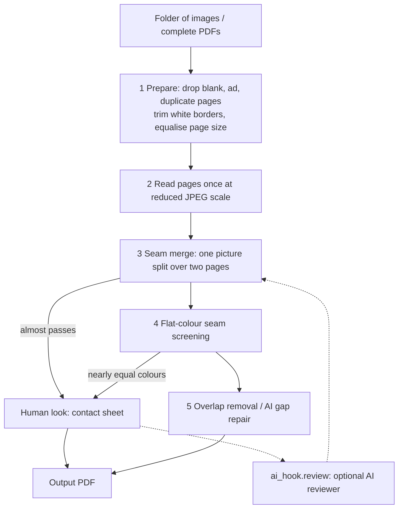

# PhotobookAutoEditor

Automatic tidy-up of photobook scans. Give it a folder of page images or complete PDFs and get one clean PDF per book:
blank, ad and duplicate pages removed, white borders trimmed, one page size, and pictures that were split over two pages
merged back into one double-width page. JPEGs are embedded unchanged whenever nothing had to be edited.

自动整理写真集扫描件：输入图片文件夹或完整 PDF，输出整理好的 PDF（去空白页/广告页/重复页，去白边，统一页幅，把被拆成两页的一张图重新合并）。

## Quick start

```
pip install numpy pillow pikepdf scipy opencv-python-headless
python auto.py <folder-or-pdf> [<folder-or-pdf> ...] [--out DIR] [--seam fast|full] [--no-trim]
python selftest.py          # synthetic regression test, touches no real files
```

Input is a folder of images or one or more complete PDFs (zip archives are not accepted; unpack them first).
Output goes to `<out>/<book>.pdf` (default `<input dir>/arranged`), plus contact sheets and a JSON queue for the pairs
the rules could not decide.

## Pipeline



| Stage | Status |
|---|---|
| 1 Prepare, 2 Read, 3 Seam merge | done |
| 4 Flat-colour seams | pairs are queued, nothing is merged automatically yet |
| 5 Overlap removal | works per book (`overlap_stitch.py`), not in the default pipeline |
| 5 AI gap repair | idea only |
| CUDA version of the full-resolution seam test | planned, not written |

## How the seam merge works

Every page is decoded once at the smallest JPEG scale that still has 320 rows and reduced to a 272-row RGB picture.
A pair A | B is merged only if all of these hold (`seam_match` in `photobook_lib.py`):

1. the colour difference across the seam is at most half of the difference when B is slid up or down by 9-12 rows
   (one picture cut in two only fits row for row; two photos in front of the same wall fit equally badly everywhere);
2. the seam jump is at most 2.5 times the pictures' own column-to-column change next to the seam;
3. the seam columns have structure along the height (a flat wall says nothing about alignment).

`--seam full` runs the original 2-pixel-strip rule on full-resolution pictures instead (slower, no reduction).
Measured on a private library of 2856 merged spreads and 6679 separate neighbours, the fast rule merges 97.5 % of the
spreads and 0.16 % of the separate pairs; near misses go to a contact sheet for a human look.

## Files

| File | Purpose |
|---|---|
| `auto.py` | entry point (folders / PDFs) |
| `photobook_lib.py` | core: ad/blank detection, seam rule, spread merging, PDF writing |
| `seam_load.py`, `seam_full.py` | reduced-scale loading, full-resolution seam rule |
| `ai_hook.py` | interface for an AI reviewer of undecided pairs |
| `overlap_stitch.py`, `merge_pages.py`, `verify_spreads.py` | overlapping halves, merge by decision, re-check merged pages |

Details of every tool and the measurements behind the rules: [docs/DETAILS.md](docs/DETAILS.md).

## Privacy

Nothing is uploaded anywhere. The AI hook does nothing by default; a real reviewer must read its credentials from environment
variables, never from files in this repository (`.gitignore` already excludes `.env`, key files and local configs).
